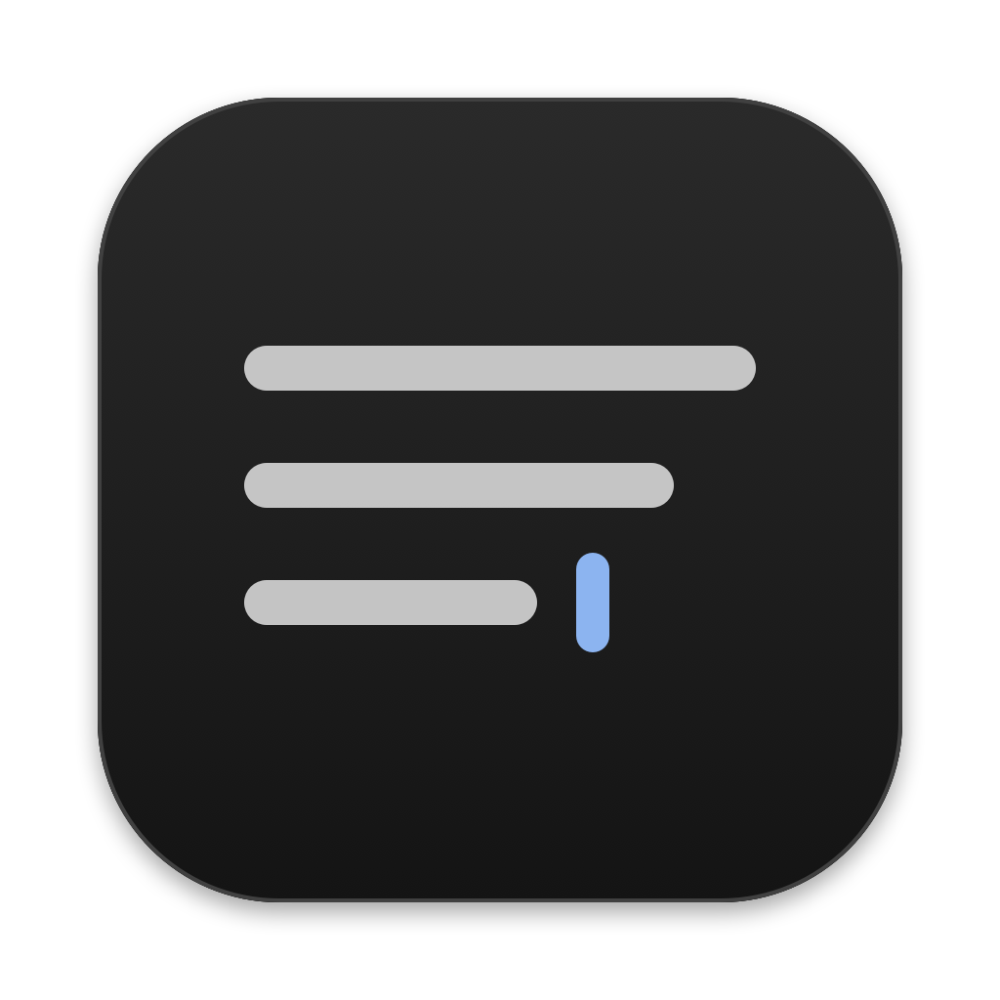

<p align="center">
  
</p>

<h1 align="center">Cedo</h1>

<p align="center">A “minimal” text editor for long-form writing.</p>

## Concept

- **For writing** — Made for long-form text, not code.
- **Plain files, quiet history** — Files stay plain text in a folder. Git keeps their history behind the scenes, and the folder remains a normal repository other tools can use.
- **Terminal alongside** — Covers what the editor can't do yet, and is a place to consult coding agents while you write.

## Installation

Cedo requires macOS 14 or later.

### From a release

Download `Cedo.dmg` from the [latest release](https://github.com/tamiroh/cedo/releases/latest), open it, and drag `Cedo.app` into the Applications folder.

The release build is not notarized by Apple. macOS may block it on first launch.

### Manual installation

To build from source, install Xcode with Swift 6.2 or later. From the repository root, run the following command to install Cedo in `/Applications`.

```sh
make install
```

To use a different destination, set `INSTALL_DIR` (for example, `make install INSTALL_DIR=~/Applications`).

## Build and run

Run directly during development:

```sh
make run
```

Build an app bundle at `build/Cedo.app`, and open it:

```sh
make app
make open
```

`make build` builds the debug version, `make test` runs the tests, and `make clean` removes build outputs.

## Usage

- Open a folder with ⌘O, then select a file to edit. Changes save automatically.
- Press ⇧⌘F to find text across the project. Use ↑ and ↓ to preview matches, Enter to open one, or Esc to return to your draft.
- Press ⌘[ to go back or ⌘] to go forward through previously opened files in the current project.
- Toggle the terminal with ⌃\`.
- Toggle the debug log, which shows saves, commits and other background activity, with ⌥⌘L.
- In Git repositories, edited files are committed after five idle minutes, when switching files or folders, or on quit. View commits in **History**.
